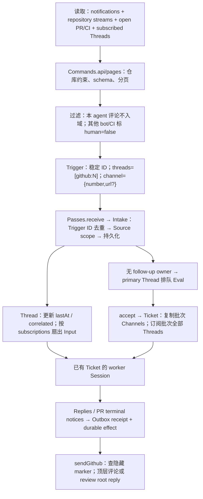
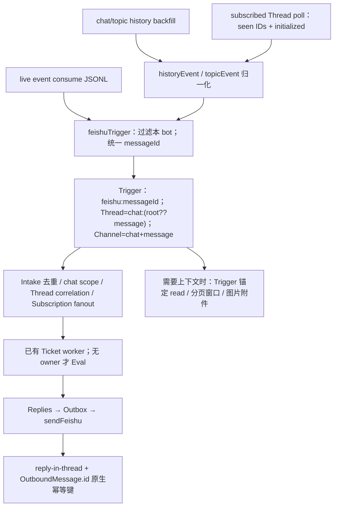

# 官方 superagent：Source / Trigger / Channel / Subscription 全链路解构

> 基线：`deepseek-ai/dsh-superagent-prototype@8c32a9dc5d72c033816c6a8110b37f40cf94fba4`。
> 范围为 `src/sources/**`（16 个文件）、`src/infra/**`（5 个）、`src/navigation.ts`，以及 `src/app/{source-context,sessions,outbox,retry-health}.ts`，合计 26 个文件。
> 指定临时目录在本子会话不可见；改用本机已有仓库的 git 对象只读检查。上述 26 个文件的 blob SHA 已逐一与官方该提交的 GitHub tree 比对，**全部一致**。本文行号均锚定该提交；没有修改官方 checkout。
> 为把 Trigger 入域后的闭环讲完整，另只读追踪 `core/{model,intake,tickets,replies,evals,part}.ts`、`policy.ts`、`app/{delivery,runtime,passes,effects}.ts`、`executor/dsh.ts` 与 `kv.ts`；它们不是本次“26 文件逐文件”清单的凑数项。

**先固定四个概念，避免把“收到”“授权”“订阅”“回写地址”混为一谈：**

| 概念 | 官方含义 | 不是什么 |
|---|---|---|
| **Source / SourceKind** | 把外部事件读成 Trigger；声明配置、接收范围、策略扩展、上下文读取器和 Channel 适配器 | 不直接决定工作授权，也不直接操作 Session |
| **Trigger** | 一条不可变外部事件：`id + source + threads[] + actor/human + addressed? + channel? + meta` | `addressed` 只表示 @ 或私聊，不等于已授权；`channel` 不存在于默认分支 CI |
| **Thread / Correlation** | Thread 是一致性边界、订阅与待评估队列的载体；一个 Trigger 属于多个 Thread 时，互相记录 `correlated` | Correlation 不是语义相似度，也不是 Feishu 的 `parentId` 回复关系 |
| **Channel / Subscription** | Channel 是“往哪里写”的地址；Subscription 是“这个 Thread 的后续 Trigger 送给哪些 Ticket”的多对多扇出关系 | Channel 不会自动产生订阅；订阅也不要求后续消息再次 @ |

入口契约分别见 [src/core/model.ts:22-39](https://github.com/deepseek-ai/dsh-superagent-prototype/blob/8c32a9dc5d72c033816c6a8110b37f40cf94fba4/src/core/model.ts#L22-L39)、[src/core/model.ts:156-181](https://github.com/deepseek-ai/dsh-superagent-prototype/blob/8c32a9dc5d72c033816c6a8110b37f40cf94fba4/src/core/model.ts#L156-L181) 和 [src/sources/kind.ts:84-115](https://github.com/deepseek-ai/dsh-superagent-prototype/blob/8c32a9dc5d72c033816c6a8110b37f40cf94fba4/src/sources/kind.ts#L84-L115)。

---

## 一、目录树逐文件

### 1.1 范围树

```text
src/
├── sources/
│   ├── kind.ts                 # SourceKind / Channel / ThreadContext 插件契约
│   ├── host.ts                 # SourceHost / SourceContext 能力边界与健康模型
│   ├── registry.ts             # 注册、配置解析、scope/channel/context 路由
│   ├── poll.ts                 # 订阅轮询 horizon、重叠读位、逐 Thread 隔离
│   ├── admission-context.ts    # 有界上下文窗口与分页循环检测
│   ├── github.ts               # GitHub Source 主循环与四条读取路径
│   ├── github-trigger.ts       # GitHub 事件 → Trigger / Channel
│   ├── github-read.ts          # GitHub 模型侧 Thread/CI 上下文读取
│   ├── github-channel.ts       # GitHub 评论回写与幂等标记
│   ├── github-pull.ts          # PR 绑定、关闭传播、跨 Channel 终态通知
│   ├── feishu.ts               # Feishu SourceKind、群范围、成员同步
│   ├── feishu-trigger.ts       # live/history/topic 三种记录 → 同一 Trigger
│   ├── feishu-loops.ts         # live consume、历史补收、订阅补轮
│   ├── feishu-read.ts          # Trigger 锚定的消息/话题/附近历史读取
│   ├── feishu-channel.ts       # 飞书话题回复与原生幂等键
│   └── feishu-image.ts         # 图片键校验、下载、安全转换、附件提交
├── infra/
│   ├── commands.ts             # gh/lark/git 子进程、分页、错误与 schema 归一化
│   ├── environment.ts          # worker CLI shim、git 凭证与环境隔离
│   ├── health.ts               # 单写者健康条目注册板
│   ├── paths.ts                # 源码树/lib 树中的包资源定位
│   └── text.ts                 # IM 字数、模板、账号名比较等文本原语
├── navigation.ts               # 面板安全打开已知 Session
└── app/
    ├── source-context.ts       # Store/Engine/Outbox → 受限 SourceContext
    ├── sessions.ts             # 主/执行体会话、消息投递、prompt/tool/skill 生命周期
    ├── outbox.ts               # 持久化回执、顺序回写、重试与终态
    └── retry-health.ts         # 从 Session 事件投影模型预算重试健康（不改重试策略）
```

### 1.2 逐文件职责与关键证据

#### `src/sources/**`

| 文件 | 职责 | 关键行 |
|---|---|---|
| [src/sources/kind.ts](https://github.com/deepseek-ai/dsh-superagent-prototype/blob/8c32a9dc5d72c033816c6a8110b37f40cf94fba4/src/sources/kind.ts) | 定义 SourceKind 的全部扩展点；`SourceChannel.send` 约定按消息 ID 幂等；`ThreadContext` 统一分页、图片和消息归一化；`SourceInstance` 是运行配置 | [45-75](https://github.com/deepseek-ai/dsh-superagent-prototype/blob/8c32a9dc5d72c033816c6a8110b37f40cf94fba4/src/sources/kind.ts#L45-L75)、[84-115](https://github.com/deepseek-ai/dsh-superagent-prototype/blob/8c32a9dc5d72c033816c6a8110b37f40cf94fba4/src/sources/kind.ts#L84-L115) |
| [src/sources/host.ts](https://github.com/deepseek-ai/dsh-superagent-prototype/blob/8c32a9dc5d72c033816c6a8110b37f40cf94fba4/src/sources/host.ts) | Source 能访问的最小宿主能力：配置、KV、Thread/Ticket/Trigger、receive、notify、health；注释明确 **receive 完成后才能推进读位** | [23-66](https://github.com/deepseek-ai/dsh-superagent-prototype/blob/8c32a9dc5d72c033816c6a8110b37f40cf94fba4/src/sources/host.ts#L23-L66)，尤其 41-45 |
| [src/sources/registry.ts](https://github.com/deepseek-ai/dsh-superagent-prototype/blob/8c32a9dc5d72c033816c6a8110b37f40cf94fba4/src/sources/registry.ts) | 注册 kind 并占用健康条目；schema 解析失败时禁用实例并回退默认配置；统一 `scope`、`channelAllowed`、`send`、ThreadContext 和环境变量路由；插件缺失时已有 Source 不监听 | [19-57](https://github.com/deepseek-ai/dsh-superagent-prototype/blob/8c32a9dc5d72c033816c6a8110b37f40cf94fba4/src/sources/registry.ts#L19-L57)、[75-137](https://github.com/deepseek-ai/dsh-superagent-prototype/blob/8c32a9dc5d72c033816c6a8110b37f40cf94fba4/src/sources/registry.ts#L75-L137) |
| [src/sources/poll.ts](https://github.com/deepseek-ai/dsh-superagent-prototype/blob/8c32a9dc5d72c033816c6a8110b37f40cf94fba4/src/sources/poll.ts) | 订阅 Thread 轮询的公共骨架：活 Ticket 永久保留，其他只保留 14 天；`cursorAt` 回退 5 秒；逐 Thread 记录/清除 `pollError`；可中断 sleep | [5-29](https://github.com/deepseek-ai/dsh-superagent-prototype/blob/8c32a9dc5d72c033816c6a8110b37f40cf94fba4/src/sources/poll.ts#L5-L29)、[32-39](https://github.com/deepseek-ai/dsh-superagent-prototype/blob/8c32a9dc5d72c033816c6a8110b37f40cf94fba4/src/sources/poll.ts#L32-L39) |
| [src/sources/admission-context.ts](https://github.com/deepseek-ai/dsh-superagent-prototype/blob/8c32a9dc5d72c033816c6a8110b37f40cf94fba4/src/sources/admission-context.ts) | 最多读 `maxPages`；按消息 ID 去重、按 cursor 检测循环；窗口取开头 5 条和 Trigger 前后各 5 条，并报告遗漏数及是否完整 | [5-16](https://github.com/deepseek-ai/dsh-superagent-prototype/blob/8c32a9dc5d72c033816c6a8110b37f40cf94fba4/src/sources/admission-context.ts#L5-L16)、[18-41](https://github.com/deepseek-ai/dsh-superagent-prototype/blob/8c32a9dc5d72c033816c6a8110b37f40cf94fba4/src/sources/admission-context.ts#L18-L41) |
| [src/sources/github.ts](https://github.com/deepseek-ai/dsh-superagent-prototype/blob/8c32a9dc5d72c033816c6a8110b37f40cf94fba4/src/sources/github.ts) | GitHub 总装：notifications、仓库全量流、开放 Ticket 的 PR/CI、订阅 Thread 四路轮询；流独立失败、每号重试、健康阈值、读位与 ETag | [127-196](https://github.com/deepseek-ai/dsh-superagent-prototype/blob/8c32a9dc5d72c033816c6a8110b37f40cf94fba4/src/sources/github.ts#L127-L196)、[197-295](https://github.com/deepseek-ai/dsh-superagent-prototype/blob/8c32a9dc5d72c033816c6a8110b37f40cf94fba4/src/sources/github.ts#L197-L295)、[297-459](https://github.com/deepseek-ai/dsh-superagent-prototype/blob/8c32a9dc5d72c033816c6a8110b37f40cf94fba4/src/sources/github.ts#L297-L459) |
| [src/sources/github-trigger.ts](https://github.com/deepseek-ai/dsh-superagent-prototype/blob/8c32a9dc5d72c033816c6a8110b37f40cf94fba4/src/sources/github-trigger.ts) | 统一 Issue/PR/评论/review/CI 的 Trigger；评论 ID 包含 `comment.id + updated_at` 版本；@ 正则有边界；机器人和本 agent均 `human:false`；Issue/PR 共用 `github-issue` 命名空间不会撞号 | [8-18](https://github.com/deepseek-ai/dsh-superagent-prototype/blob/8c32a9dc5d72c033816c6a8110b37f40cf94fba4/src/sources/github-trigger.ts#L8-L18)、[42-76](https://github.com/deepseek-ai/dsh-superagent-prototype/blob/8c32a9dc5d72c033816c6a8110b37f40cf94fba4/src/sources/github-trigger.ts#L42-L76)、[78-107](https://github.com/deepseek-ai/dsh-superagent-prototype/blob/8c32a9dc5d72c033816c6a8110b37f40cf94fba4/src/sources/github-trigger.ts#L78-L107) |
| [src/sources/github-read.ts](https://github.com/deepseek-ai/dsh-superagent-prototype/blob/8c32a9dc5d72c033816c6a8110b37f40cf94fba4/src/sources/github-read.ts) | 面向模型的只读仓库/Issue/PR/review/CI 读取；`readGithub` 手动页码，ThreadContext 对 inline review 读真实讨论串，普通会话每页 100 | [59-69](https://github.com/deepseek-ai/dsh-superagent-prototype/blob/8c32a9dc5d72c033816c6a8110b37f40cf94fba4/src/sources/github-read.ts#L59-L69)、[98-153](https://github.com/deepseek-ai/dsh-superagent-prototype/blob/8c32a9dc5d72c033816c6a8110b37f40cf94fba4/src/sources/github-read.ts#L98-L153)、[155-177](https://github.com/deepseek-ai/dsh-superagent-prototype/blob/8c32a9dc5d72c033816c6a8110b37f40cf94fba4/src/sources/github-read.ts#L155-L177) |
| [src/sources/github-channel.ts](https://github.com/deepseek-ai/dsh-superagent-prototype/blob/8c32a9dc5d72c033816c6a8110b37f40cf94fba4/src/sources/github-channel.ts) | 回写 Issue/PR 顶层评论或 review 根讨论；发送前扫描同账号、同根讨论、同隐藏 marker 的评论实现幂等；410/锁定为 gone，404 仍重试 | [13-44](https://github.com/deepseek-ai/dsh-superagent-prototype/blob/8c32a9dc5d72c033816c6a8110b37f40cf94fba4/src/sources/github-channel.ts#L13-L44)、[46-51](https://github.com/deepseek-ai/dsh-superagent-prototype/blob/8c32a9dc5d72c033816c6a8110b37f40cf94fba4/src/sources/github-channel.ts#L46-L51) |
| [src/sources/github-pull.ts](https://github.com/deepseek-ai/dsh-superagent-prototype/blob/8c32a9dc5d72c033816c6a8110b37f40cf94fba4/src/sources/github-pull.ts) | PR 只能绑定来源 PR，或本 agent 在同仓、Ticket 同名分支上开的 PR；避免一个 PR 属两个活 Ticket；传播 merged/closed；PR 终态给非 GitHub Channel 发通知 | [31-83](https://github.com/deepseek-ai/dsh-superagent-prototype/blob/8c32a9dc5d72c033816c6a8110b37f40cf94fba4/src/sources/github-pull.ts#L31-L83)、[85-104](https://github.com/deepseek-ai/dsh-superagent-prototype/blob/8c32a9dc5d72c033816c6a8110b37f40cf94fba4/src/sources/github-pull.ts#L85-L104) |
| [src/sources/feishu.ts](https://github.com/deepseek-ai/dsh-superagent-prototype/blob/8c32a9dc5d72c033816c6a8110b37f40cf94fba4/src/sources/feishu.ts) | 声明群/私聊接收范围、mentions/all、其他群策略、成员名单同步；Channel 只允许仍被监听的 chat；注册三条后台循环 | [21-69](https://github.com/deepseek-ai/dsh-superagent-prototype/blob/8c32a9dc5d72c033816c6a8110b37f40cf94fba4/src/sources/feishu.ts#L21-L69)、[70-128](https://github.com/deepseek-ai/dsh-superagent-prototype/blob/8c32a9dc5d72c033816c6a8110b37f40cf94fba4/src/sources/feishu.ts#L70-L128)、[130-138](https://github.com/deepseek-ai/dsh-superagent-prototype/blob/8c32a9dc5d72c033816c6a8110b37f40cf94fba4/src/sources/feishu.ts#L130-L138) |
| [src/sources/feishu-trigger.ts](https://github.com/deepseek-ai/dsh-superagent-prototype/blob/8c32a9dc5d72c033816c6a8110b37f40cf94fba4/src/sources/feishu-trigger.ts) | live/history/topic 三种外部记录先归一，再生成同一个 `key('feishu', messageId)`；过滤本 bot 的 open_id/app_id；Thread 为 `chatId:(rootId ?? messageId)`；保留 parent/thread 元数据 | [8-50](https://github.com/deepseek-ai/dsh-superagent-prototype/blob/8c32a9dc5d72c033816c6a8110b37f40cf94fba4/src/sources/feishu-trigger.ts#L8-L50)、[53-89](https://github.com/deepseek-ai/dsh-superagent-prototype/blob/8c32a9dc5d72c033816c6a8110b37f40cf94fba4/src/sources/feishu-trigger.ts#L53-L89) |
| [src/sources/feishu-loops.ts](https://github.com/deepseek-ai/dsh-superagent-prototype/blob/8c32a9dc5d72c033816c6a8110b37f40cf94fba4/src/sources/feishu-loops.ts) | 串行消费 live JSONL；45 秒 ready 超时和指数重连；每分钟补收群及活跃 topic；订阅 Thread 以 seen IDs + initialized 标志补漏；群名独立刷新 | [18-105](https://github.com/deepseek-ai/dsh-superagent-prototype/blob/8c32a9dc5d72c033816c6a8110b37f40cf94fba4/src/sources/feishu-loops.ts#L18-L105)、[128-206](https://github.com/deepseek-ai/dsh-superagent-prototype/blob/8c32a9dc5d72c033816c6a8110b37f40cf94fba4/src/sources/feishu-loops.ts#L128-L206)、[208-267](https://github.com/deepseek-ai/dsh-superagent-prototype/blob/8c32a9dc5d72c033816c6a8110b37f40cf94fba4/src/sources/feishu-loops.ts#L208-L267) |
| [src/sources/feishu-read.ts](https://github.com/deepseek-ai/dsh-superagent-prototype/blob/8c32a9dc5d72c033816c6a8110b37f40cf94fba4/src/sources/feishu-read.ts) | 所有读取以已接受 Trigger 的 chat/message 为锚，拒绝模型任意指定聊天；校验响应未越界；topic 分页检测；无 topic 时回退 Trigger 前的邻近群消息；around 首读前后各 5 条 | [29-97](https://github.com/deepseek-ai/dsh-superagent-prototype/blob/8c32a9dc5d72c033816c6a8110b37f40cf94fba4/src/sources/feishu-read.ts#L29-L97)、[114-170](https://github.com/deepseek-ai/dsh-superagent-prototype/blob/8c32a9dc5d72c033816c6a8110b37f40cf94fba4/src/sources/feishu-read.ts#L114-L170) |
| [src/sources/feishu-channel.ts](https://github.com/deepseek-ai/dsh-superagent-prototype/blob/8c32a9dc5d72c033816c6a8110b37f40cf94fba4/src/sources/feishu-channel.ts) | 对 Trigger 的 `messageId` 做 `--reply-in-thread`；以 `OutboundMessage.id` 作飞书原生 `--idempotency-key`；撤回/不存在映射 gone | [9-34](https://github.com/deepseek-ai/dsh-superagent-prototype/blob/8c32a9dc5d72c033816c6a8110b37f40cf94fba4/src/sources/feishu-channel.ts#L9-L34) |
| [src/sources/feishu-image.ts](https://github.com/deepseek-ai/dsh-superagent-prototype/blob/8c32a9dc5d72c033816c6a8110b37f40cf94fba4/src/sources/feishu-image.ts) | 图片 key 必须来自该消息文本；检查模型图像模态；下载到独立临时目录，校验 realpath 不越界、扩展名、普通文件及双层字节上限；保存附件后始终清理 | [11-54](https://github.com/deepseek-ai/dsh-superagent-prototype/blob/8c32a9dc5d72c033816c6a8110b37f40cf94fba4/src/sources/feishu-image.ts#L11-L54) |

#### `src/infra/**`、`src/navigation.ts`

| 文件 | 职责 | 关键行 |
|---|---|---|
| [src/infra/commands.ts](https://github.com/deepseek-ai/dsh-superagent-prototype/blob/8c32a9dc5d72c033816c6a8110b37f40cf94fba4/src/infra/commands.ts) | 90 秒/16 MiB 子进程边界；错误只保留脱敏 stderr 和 HTTP/Feishu code；`validItems` 单条跳过；GitHub 路径强制限制在配置仓库；`pages = --paginate --slurp` | [14-47](https://github.com/deepseek-ai/dsh-superagent-prototype/blob/8c32a9dc5d72c033816c6a8110b37f40cf94fba4/src/infra/commands.ts#L14-L47)、[55-115](https://github.com/deepseek-ai/dsh-superagent-prototype/blob/8c32a9dc5d72c033816c6a8110b37f40cf94fba4/src/infra/commands.ts#L55-L115) |
| [src/infra/environment.ts](https://github.com/deepseek-ai/dsh-superagent-prototype/blob/8c32a9dc5d72c033816c6a8110b37f40cf94fba4/src/infra/environment.ts) | worker 的 gh/lark/git shim 与隔离 gitconfig；原子替换且拒绝覆盖外来文件；清理 ambient token、Git 位置和交互凭证；校验仓库未注入凭证 | [33-58](https://github.com/deepseek-ai/dsh-superagent-prototype/blob/8c32a9dc5d72c033816c6a8110b37f40cf94fba4/src/infra/environment.ts#L33-L58)、[75-124](https://github.com/deepseek-ai/dsh-superagent-prototype/blob/8c32a9dc5d72c033816c6a8110b37f40cf94fba4/src/infra/environment.ts#L75-L124)、[137-157](https://github.com/deepseek-ai/dsh-superagent-prototype/blob/8c32a9dc5d72c033816c6a8110b37f40cf94fba4/src/infra/environment.ts#L137-L157) |
| [src/infra/health.ts](https://github.com/deepseek-ai/dsh-superagent-prototype/blob/8c32a9dc5d72c033816c6a8110b37f40cf94fba4/src/infra/health.ts) | 健康条目单写者 claim/release；旧 Source 注册释放后，迟到的写入变成 no-op | [11-35](https://github.com/deepseek-ai/dsh-superagent-prototype/blob/8c32a9dc5d72c033816c6a8110b37f40cf94fba4/src/infra/health.ts#L11-L35) |
| [src/infra/paths.ts](https://github.com/deepseek-ai/dsh-superagent-prototype/blob/8c32a9dc5d72c033816c6a8110b37f40cf94fba4/src/infra/paths.ts) | 最多向上 6 层寻找名称确为 `dsh-superagent` 的 package.json，兼容源码与编译产物资源定位 | [6-20](https://github.com/deepseek-ai/dsh-superagent-prototype/blob/8c32a9dc5d72c033816c6a8110b37f40cf94fba4/src/infra/paths.ts#L6-L20) |
| [src/infra/text.ts](https://github.com/deepseek-ai/dsh-superagent-prototype/blob/8c32a9dc5d72c033816c6a8110b37f40cf94fba4/src/infra/text.ts) | 中英混排词数、IM 100 词硬限制、健康模板替换、GitHub 名称大小写无关比较、正则转义 | [1-20](https://github.com/deepseek-ai/dsh-superagent-prototype/blob/8c32a9dc5d72c033816c6a8110b37f40cf94fba4/src/infra/text.ts#L1-L20) |
| [src/navigation.ts](https://github.com/deepseek-ai/dsh-superagent-prototype/blob/8c32a9dc5d72c033816c6a8110b37f40cf94fba4/src/navigation.ts) | 面板跳转前刷新 Session catalog，区分 `not-ready` 与 `not-listed`，支持 abort；**不参与事件接收或执行体唤醒** | [5-23](https://github.com/deepseek-ai/dsh-superagent-prototype/blob/8c32a9dc5d72c033816c6a8110b37f40cf94fba4/src/navigation.ts#L5-L23) |

#### 关联的 `src/app/**`

| 文件 | 职责 | 关键行 |
|---|---|---|
| [src/app/source-context.ts](https://github.com/deepseek-ai/dsh-superagent-prototype/blob/8c32a9dc5d72c033816c6a8110b37f40cf94fba4/src/app/source-context.ts) | 把 Store、Engine、Outbox 包装成 Source 受限端口；`receive` 经 Passes，`notify` 经 Outbox；健康写入绑定当前注册代际 | [29-71](https://github.com/deepseek-ai/dsh-superagent-prototype/blob/8c32a9dc5d72c033816c6a8110b37f40cf94fba4/src/app/source-context.ts#L29-L71) |
| [src/app/sessions.ts](https://github.com/deepseek-ai/dsh-superagent-prototype/blob/8c32a9dc5d72c033816c6a8110b37f40cf94fba4/src/app/sessions.ts) | 创建/恢复主 Session 与 worker；`prompt` 以 request ID 幂等投递；relay/notice 走持久 Effects；配置 prompt、tools、skills；聚合 RetryHealth | [88-186](https://github.com/deepseek-ai/dsh-superagent-prototype/blob/8c32a9dc5d72c033816c6a8110b37f40cf94fba4/src/app/sessions.ts#L88-L186)、[205-351](https://github.com/deepseek-ai/dsh-superagent-prototype/blob/8c32a9dc5d72c033816c6a8110b37f40cf94fba4/src/app/sessions.ts#L205-L351) |
| [src/app/outbox.ts](https://github.com/deepseek-ai/dsh-superagent-prototype/blob/8c32a9dc5d72c033816c6a8110b37f40cf94fba4/src/app/outbox.ts) | receipt 与 reply effect 同事务；重复消息 ID 忽略；全局顺序投递；同 Ticket/会话前序失败会挡住后续；Source 关闭等待、地址忽略或 gone 则落终态 | [17-51](https://github.com/deepseek-ai/dsh-superagent-prototype/blob/8c32a9dc5d72c033816c6a8110b37f40cf94fba4/src/app/outbox.ts#L17-L51) |
| [src/app/retry-health.ts](https://github.com/deepseek-ai/dsh-superagent-prototype/blob/8c32a9dc5d72c033816c6a8110b37f40cf94fba4/src/app/retry-health.ts) | 重放有序 Session 事件，按 seq/turn/step 防旧事件覆盖；只识别预算耗尽并投影等待状态；assistant 同 provider 消息或 idle/dispose 清除；**不改变模型重试策略** | [9-27](https://github.com/deepseek-ai/dsh-superagent-prototype/blob/8c32a9dc5d72c033816c6a8110b37f40cf94fba4/src/app/retry-health.ts#L9-L27)、[29-90](https://github.com/deepseek-ai/dsh-superagent-prototype/blob/8c32a9dc5d72c033816c6a8110b37f40cf94fba4/src/app/retry-health.ts#L29-L90) |

---

## 二、两条数据流

### 2.1 GitHub：通知/仓库流/订阅读取 → Trigger → Ticket → 评论



#### A. 四条读取路径与读位

1. **Notifications（显式通知主入口）**：`github-since` 首次固定为本轮开始时间，不回读历史；请求 `notifications?all=true&per_page=50&since=...`。响应的 `X-Poll-Interval` 决定下轮间隔且最低 60 秒；有 `rel="next"` 才再走 `Commands.pages` 拉全页。通知只负责指出 Issue/PR 号，随后按号读取正文、三类评论和 review；上轮失败号排在新的通知前。[src/sources/github.ts:297-342](https://github.com/deepseek-ai/dsh-superagent-prototype/blob/8c32a9dc5d72c033816c6a8110b37f40cf94fba4/src/sources/github.ts#L297-L342)
2. **Repository streams（主动观察入口）**：`issues`、`issues/comments`、`pulls/comments` 各有独立 `github-stream:<stream>`。开关首次启用从“现在”开始；关闭删除读位；Issue 与 PR 还分别记录 `started`，避免后开的一类被旧起点放回。请求按 `updated asc + per_page=100 + since` 读取。[src/sources/github.ts:171-249](https://github.com/deepseek-ai/dsh-superagent-prototype/blob/8c32a9dc5d72c033816c6a8110b37f40cf94fba4/src/sources/github.ts#L171-L249)
3. **开放 Ticket 的 PR 与 CI**：每个开放 PR 每轮至多读取一次（`round.pulls` 共享 Promise），再读取 check runs/statuses；首次只建立 fingerprint 基线，变化才生成带递增 revision 的 CI Trigger。[src/sources/github.ts:375-423](https://github.com/deepseek-ai/dsh-superagent-prototype/blob/8c32a9dc5d72c033816c6a8110b37f40cf94fba4/src/sources/github.ts#L375-L423)
4. **Subscribed Threads（后续讨论兜底入口）**：活 Ticket 的 Thread 一直轮询，其他只在最近活动/结束后 14 天内轮询；本轮 notifications 已读的号跳过。每个号与通知路径共享 `github-cursor:<number>`，因此两条路径不会各推进一份互不一致的水位。[src/sources/github.ts:429-459](https://github.com/deepseek-ai/dsh-superagent-prototype/blob/8c32a9dc5d72c033816c6a8110b37f40cf94fba4/src/sources/github.ts#L429-L459)、[src/sources/poll.ts:5-29](https://github.com/deepseek-ai/dsh-superagent-prototype/blob/8c32a9dc5d72c033816c6a8110b37f40cf94fba4/src/sources/poll.ts#L5-L29)

#### B. 条件请求与分页不是一套逻辑，不能混写

- **ETag 只用于 repository streams，不用于 notifications。** 只有“存储的 `since` 经 14 天 horizon 截断后仍等于本次 `since`”才带 `If-None-Match`；`gh` 把 304 当非零退出，`Commands` 转成 `CliError(code=304)`，`readStream` 捕获后直接返回，不推进读位。[src/sources/github.ts:203-218](https://github.com/deepseek-ai/dsh-superagent-prototype/blob/8c32a9dc5d72c033816c6a8110b37f40cf94fba4/src/sources/github.ts#L203-L218)、[src/infra/commands.ts:17-31](https://github.com/deepseek-ai/dsh-superagent-prototype/blob/8c32a9dc5d72c033816c6a8110b37f40cf94fba4/src/infra/commands.ts#L17-L31)
- 读完一页后，读位取 `max(旧 since, 本页最新 updated_at - 5s)`；**只有读位不动时才保存这次 ETag**，读位前进就丢弃旧 ETag，保证条件请求永远对应同一请求语义。[src/sources/github.ts:243-249](https://github.com/deepseek-ai/dsh-superagent-prototype/blob/8c32a9dc5d72c033816c6a8110b37f40cf94fba4/src/sources/github.ts#L243-L249)
- stream 的 100 条页不是用 `Link` 递归到底，而是“处理一页 → 前移 since → 下轮取下一批”；notifications、评论、CI 和 Channel marker 扫描才由 `Commands.pages` 使用 `gh api --paginate --slurp` 拉全。[src/infra/commands.ts:89-98](https://github.com/deepseek-ai/dsh-superagent-prototype/blob/8c32a9dc5d72c033816c6a8110b37f40cf94fba4/src/infra/commands.ts#L89-L98)
- 模型侧读取另有分页：`readGithub` 每页 20 并返回 `next_resource`；普通 conversation 每页 100；最上层 `admissionContext` 再限制最大页数并检测重复 cursor。[src/sources/github-read.ts:133-153](https://github.com/deepseek-ai/dsh-superagent-prototype/blob/8c32a9dc5d72c033816c6a8110b37f40cf94fba4/src/sources/github-read.ts#L133-L153)、[src/sources/admission-context.ts:22-41](https://github.com/deepseek-ai/dsh-superagent-prototype/blob/8c32a9dc5d72c033816c6a8110b37f40cf94fba4/src/sources/admission-context.ts#L22-L41)

#### C. 去重、机器人过滤与 Trigger/Thread/Channel 成形

- 本 agent写的 Issue/PR/评论在 Source 层直接跳过，防止自己的回写形成自触发环；其他 GitHub bot/App 以及本 agent在 Trigger 上都标为 `human:false`。[src/sources/github.ts:224-241](https://github.com/deepseek-ai/dsh-superagent-prototype/blob/8c32a9dc5d72c033816c6a8110b37f40cf94fba4/src/sources/github.ts#L224-L241)、[src/sources/github.ts:384-401](https://github.com/deepseek-ai/dsh-superagent-prototype/blob/8c32a9dc5d72c033816c6a8110b37f40cf94fba4/src/sources/github.ts#L384-L401)
- 非本 agent bot 并非全在 Source 丢弃：Source 先保留事件，Policy 的 `machineGate` 只允许名单内 bot 在“被 @ 或对应 observe 开启”时成为 **inferred** 候选，永远不成为人的显式授权。[src/policy.ts:166-187](https://github.com/deepseek-ai/dsh-superagent-prototype/blob/8c32a9dc5d72c033816c6a8110b37f40cf94fba4/src/policy.ts#L166-L187)
- Issue/PR 的稳定 ID 是类型+编号；评论是 URL/编号+评论 ID+更新时间版本；与 Feishu 的纯消息 ID 不同，**GitHub 评论编辑可形成新版本 Trigger**，重叠读取相同版本才会被去重。[src/sources/github-trigger.ts:64-76](https://github.com/deepseek-ai/dsh-superagent-prototype/blob/8c32a9dc5d72c033816c6a8110b37f40cf94fba4/src/sources/github-trigger.ts#L64-L76)
- `githubChannel(number,url)` 同时给出 Thread `github:<number>` 和写回地址 `{number,url?}`。普通评论回到 Issue/PR 顶层；URL 含 `#discussion_r<id>` 时，Channel 先定位 review 根评论再回复根讨论，根评论被删则退化为顶层 PR 评论。[src/sources/github-trigger.ts:7-18](https://github.com/deepseek-ai/dsh-superagent-prototype/blob/8c32a9dc5d72c033816c6a8110b37f40cf94fba4/src/sources/github-trigger.ts#L7-L18)、[src/sources/github-channel.ts:23-40](https://github.com/deepseek-ai/dsh-superagent-prototype/blob/8c32a9dc5d72c033816c6a8110b37f40cf94fba4/src/sources/github-channel.ts#L23-L40)

#### D. Intake → Correlation → Subscription → 执行体

1. `Intake.receive` 先规范化时间、检查至少一个 Thread、按 Trigger ID 去重，再做 Source scope；被 scope 拒绝的 Trigger 也保存并记录 `filtered` disposition，便于审计。[src/core/intake.ts:19-30](https://github.com/deepseek-ai/dsh-superagent-prototype/blob/8c32a9dc5d72c033816c6a8110b37f40cf94fba4/src/core/intake.ts#L19-L30)
2. 一个 Trigger 的每个 ThreadRef 都会创建/读取 Thread，更新 `lastAt`，把其余 Thread key 写入 `correlated`。当前 GitHub Source 构造函数每次只给一个 Thread，但通用引擎支持多 Thread 扇出。[src/core/intake.ts:31-48](https://github.com/deepseek-ai/dsh-superagent-prototype/blob/8c32a9dc5d72c033816c6a8110b37f40cf94fba4/src/core/intake.ts#L31-L48)
3. Eval accept 创建 Ticket 时，按 JSON 完整值去重收集本批 Trigger 的 Channels，并订阅本批所有 Threads；此后 Thread 上每个 Trigger 都按 `subscriptions` 变成确定 ID 的 Ticket Input。[src/core/tickets.ts:32-55](https://github.com/deepseek-ai/dsh-superagent-prototype/blob/8c32a9dc5d72c033816c6a8110b37f40cf94fba4/src/core/tickets.ts#L32-L55)、[src/core/intake.ts:49-60](https://github.com/deepseek-ai/dsh-superagent-prototype/blob/8c32a9dc5d72c033816c6a8110b37f40cf94fba4/src/core/intake.ts#L49-L60)
4. Input 由 durable `delivery` effect 逐条送入 `worker-<ticketId>`；`Sessions.prompt` 以 `input.id` 为 request ID，`AgentDelivery` 同时查持久历史与 nextTurn/nextStep inbox，最后 flush，重启重试不会重复注入。[src/executor/dsh.ts:287-350](https://github.com/deepseek-ai/dsh-superagent-prototype/blob/8c32a9dc5d72c033816c6a8110b37f40cf94fba4/src/executor/dsh.ts#L287-L350)、[src/app/delivery.ts:26-85](https://github.com/deepseek-ai/dsh-superagent-prototype/blob/8c32a9dc5d72c033816c6a8110b37f40cf94fba4/src/app/delivery.ts#L26-L85)

#### E. Channel 回写：多个 Channel 不等于所有回复都广播

- acknowledgement 回到被接受 Trigger 的 Channel；answer 回到提问 Trigger 的 Channel；attention 回到引发问题的消息，缺失时回 Ticket 起点；普通 result 回 origin Channel，origin 无 Channel 才用 `ticket.channels[0]`。[src/core/replies.ts:39-94](https://github.com/deepseek-ai/dsh-superagent-prototype/blob/8c32a9dc5d72c033816c6a8110b37f40cf94fba4/src/core/replies.ts#L39-L94)
- 因而 `ticket.channels[]` 是可用地址集合，**不是普通 result 的广播列表**。多来源提问可分别 answer 到各自 Channel；真正显式广播的是 PR merged/closed 终态：`pullEndNotices` 对每个非 GitHub Channel 各生成一条确定 ID 的通知，GitHub 时间线已有终态所以跳过。[src/sources/github-pull.ts:85-104](https://github.com/deepseek-ai/dsh-superagent-prototype/blob/8c32a9dc5d72c033816c6a8110b37f40cf94fba4/src/sources/github-pull.ts#L85-L104)、[src/app/runtime.ts:142-152](https://github.com/deepseek-ai/dsh-superagent-prototype/blob/8c32a9dc5d72c033816c6a8110b37f40cf94fba4/src/app/runtime.ts#L142-L152)
- Outbox 先持久化 receipt 和 effect，再串行发送。GitHub 发送前扫描同账号、同根讨论中包含 `&lt;!-- dsh-superagent:${message.id} --&gt;` 的评论；命中即视为 sent，否则 POST 带 marker 的新评论。这样覆盖“远端已写入、本地未 settle 就崩溃”的不确定窗口。[src/app/outbox.ts:26-50](https://github.com/deepseek-ai/dsh-superagent-prototype/blob/8c32a9dc5d72c033816c6a8110b37f40cf94fba4/src/app/outbox.ts#L26-L50)、[src/sources/github-channel.ts:33-40](https://github.com/deepseek-ai/dsh-superagent-prototype/blob/8c32a9dc5d72c033816c6a8110b37f40cf94fba4/src/sources/github-channel.ts#L33-L40)

### 2.2 Feishu：live + backfill + subscribed poll → 同一 Trigger → 话题回复



#### A. 三条入口汇合到同一个 Trigger，而不是三套事件体系

1. **Live**：启动 `lark-cli event consume im.message.receive_v1 --as bot`，stdout 每行一个 JSON，promise chain 保证接收顺序；单行上限 1 MiB，45 秒未 ready 会终止，稳定运行 60 秒后的重连等待重置为 1 秒，否则指数到 60 秒。[src/sources/feishu-loops.ts:42-105](https://github.com/deepseek-ai/dsh-superagent-prototype/blob/8c32a9dc5d72c033816c6a8110b37f40cf94fba4/src/sources/feishu-loops.ts#L42-L105)
2. **Backfill**：每个已配置群和已知私聊有 `feishu-history:<chat>`；首次只记本轮开始时间，下轮开始补收。先按 chat 扫，再按活跃 topic 扫，均为升序、每页 50、带 `[since,until]`；响应若越过请求的 chat/thread 直接失败，deleted 跳过。[src/sources/feishu-loops.ts:128-206](https://github.com/deepseek-ai/dsh-superagent-prototype/blob/8c32a9dc5d72c033816c6a8110b37f40cf94fba4/src/sources/feishu-loops.ts#L128-L206)
3. **Subscribed poll**：每个 Thread 保存 `thread-seen:<threadKey>` 和 `thread-initialized:<threadKey>`。第一次先把 root/parent 标为已见，避免把上下文当新工作；之后倒序翻页，遇到已知消息即可停止。首次仍逐条过滤早于订阅创建时间的消息。[src/sources/feishu-loops.ts:208-267](https://github.com/deepseek-ai/dsh-superagent-prototype/blob/8c32a9dc5d72c033816c6a8110b37f40cf94fba4/src/sources/feishu-loops.ts#L208-L267)
4. history 与 topic 记录先转为 live Event 形状，最后都调用 `feishuTrigger`。它过滤 bot 自身 open_id/app_id，生成确定 Trigger ID，以 root/message 形成 Thread，并把当前消息 ID 放进 Channel；所以三路径重叠只是 `duplicate`，不会生成三张 Ticket。[src/sources/feishu-trigger.ts:30-50](https://github.com/deepseek-ai/dsh-superagent-prototype/blob/8c32a9dc5d72c033816c6a8110b37f40cf94fba4/src/sources/feishu-trigger.ts#L30-L50)、[src/sources/feishu-trigger.ts:74-89](https://github.com/deepseek-ai/dsh-superagent-prototype/blob/8c32a9dc5d72c033816c6a8110b37f40cf94fba4/src/sources/feishu-trigger.ts#L74-L89)

#### B. 接收范围、机器人、分页循环检测

- 私聊由 `directMessages` 决定；配置群始终 `listened`，`listen=all` 只决定 `observed`；其他群可设为不接收或仅 @。**mentions 模式的“仅 @”是 Eval 准入语义，不会在 Intake 前丢掉已有 Ticket Thread 的人类后续。** 不在接收范围的 chat 才先记 `filtered`，不扇出。[src/sources/feishu.ts:54-64](https://github.com/deepseek-ai/dsh-superagent-prototype/blob/8c32a9dc5d72c033816c6a8110b37f40cf94fba4/src/sources/feishu.ts#L54-L64)
- 其他 bot 的消息仍是 `human:false`；与 GitHub 共用 Policy 机器门，仅名单 bot 能成为 inferred candidate，不能显式发起/停止工作。[src/sources/feishu-trigger.ts:37-43](https://github.com/deepseek-ai/dsh-superagent-prototype/blob/8c32a9dc5d72c033816c6a8110b37f40cf94fba4/src/sources/feishu-trigger.ts#L37-L43)、[src/policy.ts:170-182](https://github.com/deepseek-ai/dsh-superagent-prototype/blob/8c32a9dc5d72c033816c6a8110b37f40cf94fba4/src/policy.ts#L170-L182)
- history 若 `has_more` 却缺 token 或 token 重复，立即报错而不是死循环；thread context 同样检查 token 是否前进；通用 admission reader 另用 cursor 集合兜底。[src/sources/feishu-loops.ts:171-195](https://github.com/deepseek-ai/dsh-superagent-prototype/blob/8c32a9dc5d72c033816c6a8110b37f40cf94fba4/src/sources/feishu-loops.ts#L171-L195)、[src/sources/feishu-read.ts:75-87](https://github.com/deepseek-ai/dsh-superagent-prototype/blob/8c32a9dc5d72c033816c6a8110b37f40cf94fba4/src/sources/feishu-read.ts#L75-L87)
- 还有两种“环”被分别处理：事件消费进程异常退出用有界指数退避；本 bot 消息在 Trigger 构造时直接丢弃，防止机器人回复再次驱动自己。[src/sources/feishu-loops.ts:63-69](https://github.com/deepseek-ai/dsh-superagent-prototype/blob/8c32a9dc5d72c033816c6a8110b37f40cf94fba4/src/sources/feishu-loops.ts#L63-L69)

#### C. 上下文与图片在按需读取阶段进入，不堵塞 intake

- `feishuRead` 只允许 `feishu/<accepted-trigger-id>/{message,root,parent,thread,around}`，每次先重读 source 并校验 chat；topic 页还会校验响应 thread_id 与所有消息归属。[src/sources/feishu-read.ts:39-97](https://github.com/deepseek-ai/dsh-superagent-prototype/blob/8c32a9dc5d72c033816c6a8110b37f40cf94fba4/src/sources/feishu-read.ts#L39-L97)
- 没有 topic 时，ThreadContext 回退为 Trigger 前的 5 条群消息；`around` 首次合并前后各 5 条并按 message_id 去重，后续每次向更老读 10 条。[src/sources/feishu-read.ts:114-166](https://github.com/deepseek-ai/dsh-superagent-prototype/blob/8c32a9dc5d72c033816c6a8110b37f40cf94fba4/src/sources/feishu-read.ts#L114-L166)
- 图片不会随 live/backfill 自动下载。评估选中消息里的 `img_...` key 后才读取，且 key、消息 ID、模型模态、临时目录边界、格式、大小全部验证，再交给 attachment service。[src/sources/feishu-image.ts:11-54](https://github.com/deepseek-ai/dsh-superagent-prototype/blob/8c32a9dc5d72c033816c6a8110b37f40cf94fba4/src/sources/feishu-image.ts#L11-L54)
- GitHub 的 ThreadContext 只实现 `messageId/read`，没有注册 `images/image` 扩展，不会把 Markdown 图片自动转成模型附件；官方这条按需图片管道是 Feishu 专属。[src/sources/github-read.ts:155-177](https://github.com/deepseek-ai/dsh-superagent-prototype/blob/8c32a9dc5d72c033816c6a8110b37f40cf94fba4/src/sources/github-read.ts#L155-L177)、[src/sources/registry.ts:109-122](https://github.com/deepseek-ai/dsh-superagent-prototype/blob/8c32a9dc5d72c033816c6a8110b37f40cf94fba4/src/sources/registry.ts#L109-L122)

#### D. 回复与多 Channel

Feishu 的 `Channel.address={chatId,messageId,direct?}` 始终指向当前 Trigger 消息，回答新一轮问题就回复新一轮消息的话题。`sendFeishu` 用 `--reply-in-thread` 保持话题，并把 `OutboundMessage.id` 传给平台原生幂等键；Outbox 的 receipt/effect 与 GitHub 共用。[src/sources/feishu-trigger.ts:7-18](https://github.com/deepseek-ai/dsh-superagent-prototype/blob/8c32a9dc5d72c033816c6a8110b37f40cf94fba4/src/sources/feishu-trigger.ts#L7-L18)、[src/sources/feishu-channel.ts:18-29](https://github.com/deepseek-ai/dsh-superagent-prototype/blob/8c32a9dc5d72c033816c6a8110b37f40cf94fba4/src/sources/feishu-channel.ts#L18-L29)

`channel.allowed` 还会重新计算该 chat 当前是否接收，群被移出配置后，排队中的回复落为 `channelIgnored` 而非继续外发；消息撤回/不存在则为 `channelGone`。[src/sources/feishu.ts:60-64](https://github.com/deepseek-ai/dsh-superagent-prototype/blob/8c32a9dc5d72c033816c6a8110b37f40cf94fba4/src/sources/feishu.ts#L60-L64)、[src/app/outbox.ts:39-50](https://github.com/deepseek-ai/dsh-superagent-prototype/blob/8c32a9dc5d72c033816c6a8110b37f40cf94fba4/src/app/outbox.ts#L39-L50)

### 2.3 关键问题：后续讨论为何无需再次 @ 就能到达执行体

这是 **Source 持续读取 + Thread Subscription 扇出 + follow-up owner 抑制重复 Eval** 三段共同完成的，不是把 @ 规则“放松”：

1. Ticket accept 时已订阅 origin Thread；GitHub 的 subscribed poll 会读取该 Issue/PR 的所有后续评论，Feishu live/backfill/poll 也会继续产生无 `addressed` 的 Trigger。[src/core/tickets.ts:45-53](https://github.com/deepseek-ai/dsh-superagent-prototype/blob/8c32a9dc5d72c033816c6a8110b37f40cf94fba4/src/core/tickets.ts#L45-L53)
2. Intake **先按订阅扇出，再决定是否进 Eval**。人类 Trigger 在非 context Subscription 上生成 `human:true` Input；存活 Ticket 直接 deliver，已结束但非人停止的 Ticket 可在原 Mandate 重验证后 resume。[src/core/intake.ts:38-59](https://github.com/deepseek-ai/dsh-superagent-prototype/blob/8c32a9dc5d72c033816c6a8110b37f40cf94fba4/src/core/intake.ts#L38-L59)、[src/core/tickets.ts:247-269](https://github.com/deepseek-ai/dsh-superagent-prototype/blob/8c32a9dc5d72c033816c6a8110b37f40cf94fba4/src/core/tickets.ts#L247-L269)
3. `followupOwners` 找出仍有权判断这条消息的 worker；有 owner 就不重复排队 Eval，主 Session 也不能把它抢走去开第二张 Ticket。worker 若认为超范围可 handback，所有 owner 放手后才重新 Eval。[src/core/model.ts:68-88](https://github.com/deepseek-ai/dsh-superagent-prototype/blob/8c32a9dc5d72c033816c6a8110b37f40cf94fba4/src/core/model.ts#L68-L88)、[src/core/evals.ts:176-187](https://github.com/deepseek-ai/dsh-superagent-prototype/blob/8c32a9dc5d72c033816c6a8110b37f40cf94fba4/src/core/evals.ts#L176-L187)
4. context-only Subscription 也会送 Input，但标 `context:true`，不授予工作权、不恢复已结束 Ticket、不允许在该 Thread acknowledgement；人类停止的 Ticket 同样不会被后续消息自动复活。[src/core/model.ts:163-171](https://github.com/deepseek-ai/dsh-superagent-prototype/blob/8c32a9dc5d72c033816c6a8110b37f40cf94fba4/src/core/model.ts#L163-L171)、[src/core/replies.ts:48-61](https://github.com/deepseek-ai/dsh-superagent-prototype/blob/8c32a9dc5d72c033816c6a8110b37f40cf94fba4/src/core/replies.ts#L48-L61)
5. 对未订阅 Thread，无 @ 人类消息仍按 admission/observed 规则判断；所以“后续无需 @”是订阅带来的归属，**不是全仓库无 @ 都自动执行**。[src/policy.ts:191-210](https://github.com/deepseek-ai/dsh-superagent-prototype/blob/8c32a9dc5d72c033816c6a8110b37f40cf94fba4/src/policy.ts#L191-L210)

---

## 三、读位与幂等

### 3.1 总体不变量：至少一次读取 + 幂等入域 + 幂等外写

官方不是追求传输层“恰好一次”。它允许 5 秒重叠、live/backfill/poll 重读、失败重试和崩溃后重放，然后用四层确定 ID 消除副作用：

| 层 | 幂等键与检查位置 | 崩溃/重放表现 |
|---|---|---|
| 外部事件 → Trigger | GitHub issue/comment/CI 的版本化 ID；Feishu `messageId`；Intake 先查 Trigger 再处理 | 同一版本重复读取返回 `duplicate`，不再次扇出、不再次 Eval |
| Trigger → Ticket Input / Session | `key('input',ticketId,'trigger',trigger.id)`；Session request ID=input.id；AgentDelivery 查历史+inbox | effect 重试不会重复追加 Input 或重复注入 worker；flush 后才确认生产者 |
| Ticket → 外部 Channel | OutboundMessage.id + 持久 receipt；GitHub 隐藏 marker 查重；Feishu 平台 idempotency key | “远端成功、本地未记成功”时重试仍不会发两条 |
| Ticket 创建 | origin Trigger 已有 accept Decision 时返回旧 Decision，不另开 Ticket | Eval 重放/旧版本恢复不会双开执行体 |

依据：[src/core/intake.ts:19-30](https://github.com/deepseek-ai/dsh-superagent-prototype/blob/8c32a9dc5d72c033816c6a8110b37f40cf94fba4/src/core/intake.ts#L19-L30)、[src/core/tickets.ts:230-245](https://github.com/deepseek-ai/dsh-superagent-prototype/blob/8c32a9dc5d72c033816c6a8110b37f40cf94fba4/src/core/tickets.ts#L230-L245)、[src/core/evals.ts:131-145](https://github.com/deepseek-ai/dsh-superagent-prototype/blob/8c32a9dc5d72c033816c6a8110b37f40cf94fba4/src/core/evals.ts#L131-L145)、[src/app/delivery.ts:61-85](https://github.com/deepseek-ai/dsh-superagent-prototype/blob/8c32a9dc5d72c033816c6a8110b37f40cf94fba4/src/app/delivery.ts#L61-L85)。

### 3.2 每类读位何时推进、何时不推进

| 状态键 | 首次/重置 | 成功推进 | 失败与恢复 |
|---|---|---|---|
| `github-since` + `github-retry` | 首次通知轮把 since 固定为本轮开始，不补旧通知 | 所有本号读取完成或登记 retry 后，**在同一 atomic 中**把全局 since 推到 `round.started-5s` 并保存 retry map | 单号失败保留该号自己的 since，下轮优先重读；全局通知读位不会被一个坏号永久卡住 |
| `github-cursor:<number>` | 首次用通知 since 或 Thread.createdAt | 该 Issue/PR 正文和评论全部 `await receive` 后，推到本轮开始-5s | 中途停止/失败不写；notifications 与 subscribed poll 共用，避免双水位 |
| `github-stream:<stream>` | 开关启用时按 kind 记 started；关闭删整个 stream 状态 | 一页全部处理后写 `max(旧值,newest updated_at-5s)`；不动才携带 ETag 到下一轮 | 中途中止在写状态前抛错；304 原样返回； horizon 把过旧读位截到 14 天内的整点 |
| `github-ci:<number>` / `github-branch-ci` | 第一次仅建 fingerprint/失败集基线，不发 Trigger | 变化先 `await receive`，再保存新 fingerprint/failures 和递增 revision | 重启保留 revision，避免 CI Trigger ID 重用；运行中的检查不会过早报恢复 |
| `feishu-history:<chat>` | 首轮记录 started 并跳过，下轮才补收 | chat 与所有保留 topic 都扫描完成后写 started-5s | 任一页失败则不推进 chat 读位；下轮重读由统一 Trigger ID 去重 |
| `feishu-history-threads:<chat>` | 从消息里的 thread_id 记录 lastSeenAt | 每轮保留活跃 topic 并再扫其 replies | 超过 14 天且无仍在轮询的订阅才剪除；避免永久扫描所有老 topic |
| `thread-seen` + `thread-initialized` | 首轮先将 root/parent 标 seen | 每页处理并持久化 seen；初始化完成后，之后遇到任一 known 可提前停止 | abort 可留下未提交的本页 seen，下页重读仍由 Trigger ID 去重；首轮时间下限防止旧上下文变新工作 |
| Feishu live | 无本地读位 | receive 成功即完成该事件；消费链保持顺序 | live 与 backfill/poll 共用 messageId Trigger ID，断线补收不重复 |

对应实现：[src/kv.ts:41-57](https://github.com/deepseek-ai/dsh-superagent-prototype/blob/8c32a9dc5d72c033816c6a8110b37f40cf94fba4/src/kv.ts#L41-L57)、[src/sources/github.ts:297-373](https://github.com/deepseek-ai/dsh-superagent-prototype/blob/8c32a9dc5d72c033816c6a8110b37f40cf94fba4/src/sources/github.ts#L297-L373)、[src/sources/feishu-loops.ts:138-205](https://github.com/deepseek-ai/dsh-superagent-prototype/blob/8c32a9dc5d72c033816c6a8110b37f40cf94fba4/src/sources/feishu-loops.ts#L138-L205)。

**5 秒重叠不是读位回退 bug。** `cursorAt(started)` 统一向前一轮开始时间减 5 秒，容忍远端时间精度与迟到事件；只有确定性 Trigger ID 才能让它既“不漏”又“不重复执行”。[src/sources/poll.ts:15-16](https://github.com/deepseek-ai/dsh-superagent-prototype/blob/8c32a9dc5d72c033816c6a8110b37f40cf94fba4/src/sources/poll.ts#L15-L16)

### 3.3 失败分级与不会出现假健康

- notifications 的单号读取失败会记录 `failedAt/attempts`，连续失败满 24 小时后从 retry map 放弃，避免一个永久不可读 Thread 让 Source 永远 error；**该号 cursor 不推进**，以后新通知或订阅轮询仍可补读。410 当删除，404 仍视作可能的私有仓库权限波动而重试。[src/sources/github.ts:325-341](https://github.com/deepseek-ai/dsh-superagent-prototype/blob/8c32a9dc5d72c033816c6a8110b37f40cf94fba4/src/sources/github.ts#L325-L341)
- 一轮中 notifications、repository、PR、 subscribed Thread 尽量各自完成，再聚合错误；连续轮失败达到 `failuresBeforeError` 才报 Source error，成功一轮清零。单 Thread 的错误另写 `pollError`，不会阻止其他 Thread。[src/sources/github.ts:123-145](https://github.com/deepseek-ai/dsh-superagent-prototype/blob/8c32a9dc5d72c033816c6a8110b37f40cf94fba4/src/sources/github.ts#L123-L145)、[src/sources/github.ts:273-295](https://github.com/deepseek-ai/dsh-superagent-prototype/blob/8c32a9dc5d72c033816c6a8110b37f40cf94fba4/src/sources/github.ts#L273-L295)
- Outbox 的 reply effect 初始 5 秒、最大 5 分钟退避；前序同 Ticket/会话消息连续失败达到阈值前会挡住后序，防止状态通知倒序。Source 未安装/关闭抛 `Later` 等待，目标永久消失则 settle 为 gone，不再空转。[src/app/outbox.ts:22-50](https://github.com/deepseek-ai/dsh-superagent-prototype/blob/8c32a9dc5d72c033816c6a8110b37f40cf94fba4/src/app/outbox.ts#L22-L50)、[src/app/effects.ts:123-159](https://github.com/deepseek-ai/dsh-superagent-prototype/blob/8c32a9dc5d72c033816c6a8110b37f40cf94fba4/src/app/effects.ts#L123-L159)

### 3.4 一张“先后顺序”清单

```text
读取一页/一条
  → schema 校验（坏单条计数跳过；越界整页失败）
  → 构造确定 ID 的 Trigger
  → await ctx.receive（持久化 Trigger、correlation、fanout、disposition）
  → 本页其余事件全部完成
  → 推进 cursor / seen / ETag / CI revision

执行体侧：
Ticket Input 持久化
  → delivery effect
  → Session 历史 + inbox 查重
  → steer
  → sessionPersistence.flush
  → inputsDelivered

回复侧：
生成确定 OutboundMessage.id
  → receipt + reply effect 同事务
  → Channel allowed 再检查
  → 平台幂等发送（marker / native key）
  → receipt settle
```

这个顺序正是 `SourceHost.receive` 注释所要求的“await completion before advancing read cursors”，也是整套恢复语义的核心。[src/sources/host.ts:39-45](https://github.com/deepseek-ai/dsh-superagent-prototype/blob/8c32a9dc5d72c033816c6a8110b37f40cf94fba4/src/sources/host.ts#L39-L45)

---

## 四、可吸收到 GitHub / Gitee watcher 的清单

标记含义：**✅ 可直接吸收**＝机制与 provider 无关，照搬顺序/状态机即可；**🔧 同构改造**＝思路可直接用，但 API 字段、错误码或身份语义需做 provider 适配；**⏸ 暂不必搬**＝官方解决的是完整多 Source 多执行体问题，当前 watcher 不必引入全部复杂度。

| 优先级 | 机制 | GitHub | Gitee | 落到我们 watcher 的具体做法与验收 | 官方证据 |
|---|---|---|---|---|---|
| P0 | 确定 Trigger ID + 入域先查重 | ✅ | ✅ | GitHub 用 `kind:number`、comment 用 `commentId:updatedAt`；Gitee 同样以 provider+对象号+评论 ID+更新时间组键。先持久化事件，再 fanout/wake，重复 ID 必须返回 duplicate 且不推进业务状态。测试：同一 payload 重放两次只 wake 一次 | [src/sources/github-trigger.ts:64-76](https://github.com/deepseek-ai/dsh-superagent-prototype/blob/8c32a9dc5d72c033816c6a8110b37f40cf94fba4/src/sources/github-trigger.ts#L64-L76)、[src/core/intake.ts:19-30](https://github.com/deepseek-ai/dsh-superagent-prototype/blob/8c32a9dc5d72c033816c6a8110b37f40cf94fba4/src/core/intake.ts#L19-L30) |
| P0 | 消费成功后才推进读位 | ✅ | ✅ | 把“读取→去重→过滤→持久化→wake 请求已接受”作为 cursor 前移前置条件；会话忙、注入失败、进程停止都不得前移。测试：wake 失败后下轮仍读到同事件 | [src/sources/host.ts:39-45](https://github.com/deepseek-ai/dsh-superagent-prototype/blob/8c32a9dc5d72c033816c6a8110b37f40cf94fba4/src/sources/host.ts#L39-L45)、[src/sources/github.ts:340-373](https://github.com/deepseek-ai/dsh-superagent-prototype/blob/8c32a9dc5d72c033816c6a8110b37f40cf94fba4/src/sources/github.ts#L340-L373) |
| P0 | 读位回退 5 秒 + 去重吸收重叠 | ✅ | ✅ | 每轮使用 `pollStartedAt-5s`，不是请求结束时间；防止秒级时间戳和迟到更新漏事件。测试：边界时间两条事件不丢，重复的一条不重复 wake | [src/sources/poll.ts:15-16](https://github.com/deepseek-ai/dsh-superagent-prototype/blob/8c32a9dc5d72c033816c6a8110b37f40cf94fba4/src/sources/poll.ts#L15-L16) |
| P0 | ETag 与读位/请求指纹绑定 | ✅ | 🔧 | 仅在 `since/filter/direction/provider/repo` 完全不变时发 `If-None-Match`；cursor 前进即清 ETag；304 不动水位。Gitee 先探测是否返回/遵守 ETag，不支持则自动降级普通轮询。测试：200 新页清旧 ETag、304 不丢已缓存内容、无本地可渲染 body 时清 ETag 重取 | [src/sources/github.ts:203-249](https://github.com/deepseek-ai/dsh-superagent-prototype/blob/8c32a9dc5d72c033816c6a8110b37f40cf94fba4/src/sources/github.ts#L203-L249) |
| P0 | 每 Issue/PR 独立 cursor，多入口共享 | ✅ | ✅ | notifications、观察流和订阅补轮都读写同一 `provider-cursor:<number>`；同轮已读编号跳过，避免重复 API 与互相覆盖。测试：通知先读后订阅不重复，订阅失败后通知仍能补位 | [src/sources/github.ts:315-324](https://github.com/deepseek-ai/dsh-superagent-prototype/blob/8c32a9dc5d72c033816c6a8110b37f40cf94fba4/src/sources/github.ts#L315-L324)、[src/sources/github.ts:429-458](https://github.com/deepseek-ai/dsh-superagent-prototype/blob/8c32a9dc5d72c033816c6a8110b37f40cf94fba4/src/sources/github.ts#L429-L458) |
| P0 | 单号 retry map，不让坏项卡死全局 | ✅ | ✅ | 保存 `{since,failedAt,attempts}`；下轮先重试旧号再读新通知；全局读位与 retry map 原子写。可吸收 24h 放弃重试但**不跳过该号 cursor**的做法。测试：A 永久 500、B 正常时 B 仍被处理，A 后续恢复还能补读 | [src/sources/github.ts:315-341](https://github.com/deepseek-ai/dsh-superagent-prototype/blob/8c32a9dc5d72c033816c6a8110b37f40cf94fba4/src/sources/github.ts#L315-L341) |
| P0 | 已认领 Thread 的后续无需 @ | ✅ | ✅ | ack/认领时持久化 `subscription={provider,repo,number,sessionId}`；独立轮询这些 Issue/PR 的全部新评论。无 @ 过滤只能决定“是否新 Eval”，不能先于 subscription fanout 把消息丢弃。测试：首条 @ 唤醒后，后续无 @ 评论仍到同一会话，未认领 Issue 的无 @ 评论不唤醒 | [src/core/tickets.ts:45-53](https://github.com/deepseek-ai/dsh-superagent-prototype/blob/8c32a9dc5d72c033816c6a8110b37f40cf94fba4/src/core/tickets.ts#L45-L53)、[src/core/intake.ts:38-59](https://github.com/deepseek-ai/dsh-superagent-prototype/blob/8c32a9dc5d72c033816c6a8110b37f40cf94fba4/src/core/intake.ts#L38-L59) |
| P0 | 出站 receipt + 平台侧幂等 | ✅ | 🔧 | 持久化 `messageId/channel/status/attempts` 后再发送；GitHub 可照搬隐藏 marker 查重；Gitee 若保留 HTML comment 可复用，否则用可见但简洁的 marker 或平台幂等键。覆盖“POST 成功但进程在记回执前退出”。测试：首次结果未知后重试只有一条评论 | [src/app/outbox.ts:26-50](https://github.com/deepseek-ai/dsh-superagent-prototype/blob/8c32a9dc5d72c033816c6a8110b37f40cf94fba4/src/app/outbox.ts#L26-L50)、[src/sources/github-channel.ts:33-40](https://github.com/deepseek-ai/dsh-superagent-prototype/blob/8c32a9dc5d72c033816c6a8110b37f40cf94fba4/src/sources/github-channel.ts#L33-L40) |
| P1 | 分页必须完整且检测不前进 | ✅ | 🔧 | GitHub 用 `Link`/`--paginate`；Gitee 按实际 `Link` 或 page token 适配。每页保存已见 cursor，`has_more && (!next || seen(next))` 立即失败；不能永远只读第一页。测试：三页全到、第二页重复 token 报错且不推进水位 | [src/infra/commands.ts:89-93](https://github.com/deepseek-ai/dsh-superagent-prototype/blob/8c32a9dc5d72c033816c6a8110b37f40cf94fba4/src/infra/commands.ts#L89-L93)、[src/sources/feishu-loops.ts:171-195](https://github.com/deepseek-ai/dsh-superagent-prototype/blob/8c32a9dc5d72c033816c6a8110b37f40cf94fba4/src/sources/feishu-loops.ts#L171-L195) |
| P1 | 自己发送过滤 + bot 非人身份 | ✅ | 🔧 | 发送前记录并比较 agent login；其他 bot 统一 `human=false`，仅 bot allowlist 可进入 inferred 路径，不得具备人的 stop/显式授权。Gitee 无可靠 type 时以 login 后缀+配置名单组合判断。测试：ack 自身评论不自唤醒，普通 bot 不开工 | [src/sources/github-trigger.ts:42-47](https://github.com/deepseek-ai/dsh-superagent-prototype/blob/8c32a9dc5d72c033816c6a8110b37f40cf94fba4/src/sources/github-trigger.ts#L42-L47)、[src/policy.ts:170-182](https://github.com/deepseek-ai/dsh-superagent-prototype/blob/8c32a9dc5d72c033816c6a8110b37f40cf94fba4/src/policy.ts#L170-L182) |
| P1 | Channel 按消息语义路由，不盲目广播 | ✅ | 🔧 | 地址至少保存 `{repo,number,commentUrl?,commentId?}`；answer 回当前问题，result 回起点，review 能定位根讨论。若以后一个 Ticket 关联 GitHub+Gitee 两个 Channel，只有显式 terminal notice 才广播，不把所有 result 自动发两遍 | [src/core/replies.ts:64-94](https://github.com/deepseek-ai/dsh-superagent-prototype/blob/8c32a9dc5d72c033816c6a8110b37f40cf94fba4/src/core/replies.ts#L64-L94)、[src/sources/github-pull.ts:90-104](https://github.com/deepseek-ai/dsh-superagent-prototype/blob/8c32a9dc5d72c033816c6a8110b37f40cf94fba4/src/sources/github-pull.ts#L90-L104) |
| P1 | 活跃订阅 horizon + 活 Ticket 永久保留 | ✅ | ✅ | 已结束但非人停止的 Issue/PR 在最近 14 天继续补轮；有活任务的持续轮询；老订阅剪除以控制 API 成本。测试：第 13 天后续可到达，静默超 horizon 后不再轮询 | [src/sources/poll.ts:5-29](https://github.com/deepseek-ai/dsh-superagent-prototype/blob/8c32a9dc5d72c033816c6a8110b37f40cf94fba4/src/sources/poll.ts#L5-L29) |
| P1 | 尊重远端 poll interval，局部健康 | ✅ | 🔧 | GitHub 读取 `X-Poll-Interval` 并与本地间隔取 max；Gitee 映射其 rate-limit headers。单 Thread 记 `pollError`，连续整轮失败到阈值再报全局 error，成功即清零。测试：一个坏 Thread 不拖死其他仓库，偶发一次网络错不红 | [src/sources/github.ts:123-145](https://github.com/deepseek-ai/dsh-superagent-prototype/blob/8c32a9dc5d72c033816c6a8110b37f40cf94fba4/src/sources/github.ts#L123-L145)、[src/sources/github.ts:303-314](https://github.com/deepseek-ai/dsh-superagent-prototype/blob/8c32a9dc5d72c033816c6a8110b37f40cf94fba4/src/sources/github.ts#L303-L314) |
| P1 | 可审计的 filtered/disposition | ✅ | ✅ | 不只保存“看到的最后 ID”，还保存 `duplicate/filtered/fanout/wake/error` 及 reason code；让面板能解释无 @、非名单、bot、来源关闭分别发生了什么。测试：每类过滤都有稳定原因且不产生执行副作用 | [src/core/intake.ts:23-29](https://github.com/deepseek-ai/dsh-superagent-prototype/blob/8c32a9dc5d72c033816c6a8110b37f40cf94fba4/src/core/intake.ts#L23-L29)、[src/core/intake.ts:49-60](https://github.com/deepseek-ai/dsh-superagent-prototype/blob/8c32a9dc5d72c033816c6a8110b37f40cf94fba4/src/core/intake.ts#L49-L60) |
| P2 | Thread key 加 provider 命名空间 | ✅ | ✅ | 使用 `github:<owner>/<repo>:<number>` 与 `gitee:<owner>/<repo>:<number>`，不要只用裸 number；一个 Trigger 多 Thread 时才增加 `correlated[]`，当前 watcher 无需引入语义匹配 | [src/core/model.ts:4-12](https://github.com/deepseek-ai/dsh-superagent-prototype/blob/8c32a9dc5d72c033816c6a8110b37f40cf94fba4/src/core/model.ts#L4-L12)、[src/core/intake.ts:31-48](https://github.com/deepseek-ai/dsh-superagent-prototype/blob/8c32a9dc5d72c033816c6a8110b37f40cf94fba4/src/core/intake.ts#L31-L48) |
| P2 | CI fingerprint + revision | ✅ | 🔧 | 首次只建基线；把检查项名称/状态/结论排序后 hash，变化才生成事件，revision 入 ID；Gitee 映射其检查状态 API。测试：首轮不唤醒，同 fingerprint 不唤醒，失败→成功只唤醒一次 | [src/sources/github.ts:250-271](https://github.com/deepseek-ai/dsh-superagent-prototype/blob/8c32a9dc5d72c033816c6a8110b37f40cf94fba4/src/sources/github.ts#L250-L271)、[src/sources/github.ts:414-423](https://github.com/deepseek-ai/dsh-superagent-prototype/blob/8c32a9dc5d72c033816c6a8110b37f40cf94fba4/src/sources/github.ts#L414-L423) |
| P2 | 有界上下文、单条 schema 容错 | ✅ | ✅ | 面板/执行体需要补上下文时，限制页数、消息数与文本长度；坏单条计数跳过，跨 Thread/仓库的响应整条链失败。测试：重复 cursor 中止、坏一条不丢整页、越界消息不进入模型 | [src/sources/admission-context.ts:18-41](https://github.com/deepseek-ai/dsh-superagent-prototype/blob/8c32a9dc5d72c033816c6a8110b37f40cf94fba4/src/sources/admission-context.ts#L18-L41)、[src/infra/commands.ts:42-47](https://github.com/deepseek-ai/dsh-superagent-prototype/blob/8c32a9dc5d72c033816c6a8110b37f40cf94fba4/src/infra/commands.ts#L42-L47) |
| 暂缓 | Feishu 图片管道、完整 SourceRegistry、Mandate/Eval/多 worker Session | ⏸ | ⏸ | 当前 watcher 先把事件、水位、订阅、回写四个不变量做扎实；图片、多角色授权和完整 worker 生命周期需要独立需求，不要把整套官方架构一次性搬入 | [src/sources/feishu-image.ts:22-54](https://github.com/deepseek-ai/dsh-superagent-prototype/blob/8c32a9dc5d72c033816c6a8110b37f40cf94fba4/src/sources/feishu-image.ts#L22-L54)、[src/app/sessions.ts:137-186](https://github.com/deepseek-ai/dsh-superagent-prototype/blob/8c32a9dc5d72c033816c6a8110b37f40cf94fba4/src/app/sessions.ts#L137-L186) |

### 最小吸收顺序（减少返工）

1. **先做确定 ID、先消费后动水位、5 秒重叠**：这是不漏、不重的基础。
2. **再做 per-number cursor/retry map 与完整分页**：解决一个坏项卡全局和第一页陷阱。
3. **再做 ETag**：它是省配额优化，不能先于正确读位；我们的 GitHub 与 Gitee 要分别验证 304 语义。
4. **再做 ack 后 Subscription 补轮**：实现真正的“后续讨论无需再 @ 到同执行体”。
5. **最后做出站 receipt/marker、健康与多 Channel 规则**：把外部副作用也纳入同一套幂等闭环。

**最终判据**：任意时刻 kill 进程，重启后允许重读、允许重试，但不允许漏掉已读位之后的新事件、不允许重复 wake、不允许重复评论；一条已认领 Issue/PR 的后续人类评论无需 @ 能到原 Session，一条未认领 Thread 的无 @ 评论不能借机制越权开工。
