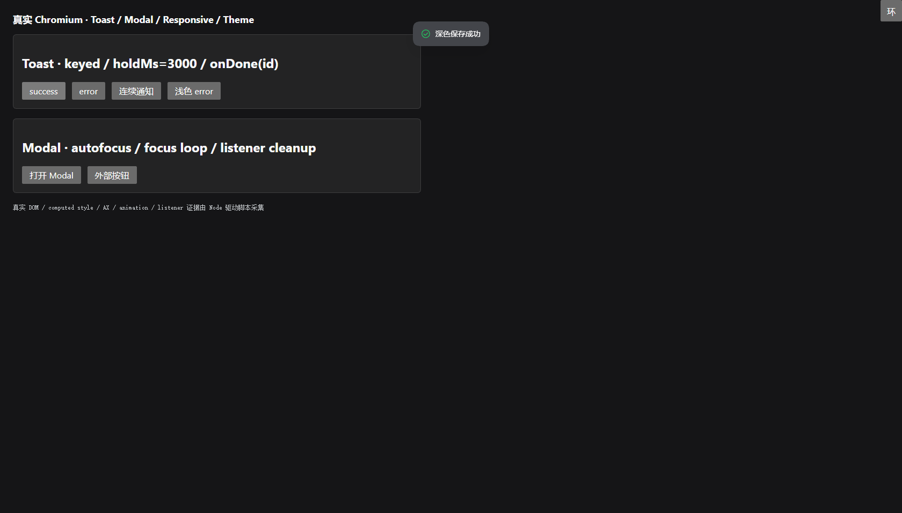
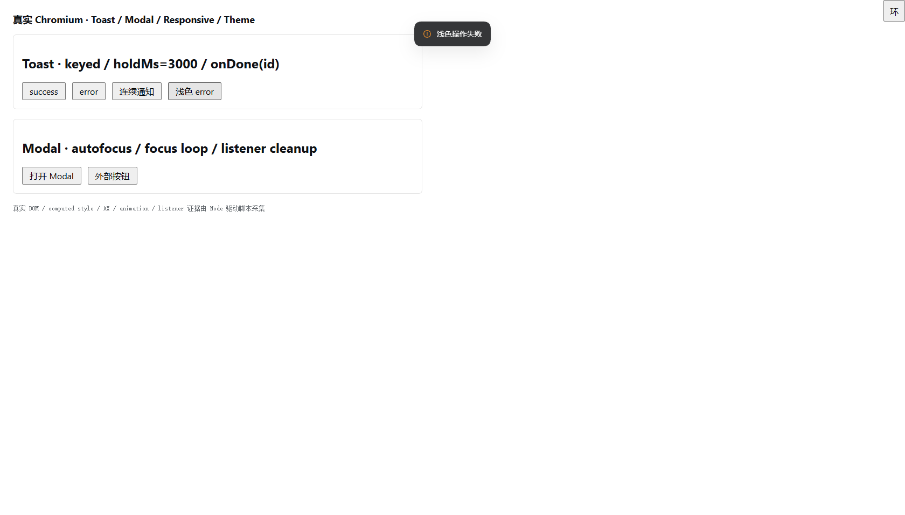
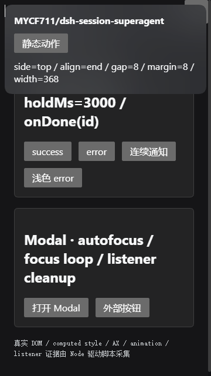

# Toast 与响应式真实 Chromium 验收（0.9.270 未验项续验）

- 日期：2026-11-06
- 最终结论：**39 passed / 0 failed / 39 total，exit 0**
- 浏览器：ego-lite 真实 Chromium `156.0.8078.74`
- 最终实测工作树：`0.9.271`（并行主线在验收期间从 `0.9.270` 前进；本任务没有修改版本）
- DSH frontend / React / primitives：`0.2.1-rc.5` / `18.3.1` / 290 exports
- 最终 task space：`72`；最终 loopback 页面：`http://127.0.0.1:62249/`
- 范围：Toast 生命周期、Modal 键盘/焦点、Orbit resize/窄视口、双主题；未进入真实 DSH Web GUI 的会话 slot。

## 1. 真实环境与证据口径

执行：

```bash
node --check scripts/verify-ui-toast-responsive.mjs
ego-browser nodejs < scripts/verify-ui-toast-responsive.mjs
```

最终命令 exit 0。脚本从安装版 `dsh-web-frontend/dist` 捕获真实 `staticModules`，以其中的同一 React、ReactDOM 和 `@deepseek-ai/dsh-client-ui-primitives` 渲染独立 harness；仓库 `createHostUi` / `createOrbitPopover` 直接作为 ESM 加载。没有假 React、假 primitives、假 DOM 或另一套定位/计时实现。

安装基线：

| 项 | 值 |
|---|---|
| 安装 asar SHA-256 | `e1b6f25fa937da98086c3e77af77aa14791105963c4d337a1c42179d232c6915` |
| 入口 JS SHA-256 | `0f3fc6b857e4f8bd4d69619ce1010240cdaaa443abf0826532a24ef8f6e32ef0` |
| vendor JS SHA-256 | `c14ba1089d78f48b8959a7bc42c9013b4a57aa4122e053d54f74c0a4d1d156a7` |
| 入口 CSS SHA-256 | `47c890e8b3898eb4e5a53933bd318e58d4cf168cd7ccef46789d48a070bba591` |
| 最终 `ui-host-primitives.js` SHA-256 | `934f9178a4413c30bb430a044d61f9ed38bc63a33994ed4e903503551940a0d1` |
| 最终 `ui-orbit-popover.js` SHA-256 | `021bc4af1a5878bd7d6662f5f9c209a452d51f621b787a76b76309e16a98e33f` |

双主题不是手写 token 或静态 preview：脚本从同一安装版 `ui-theme/lib/client.js` 提取并原样注入 8 份内嵌 `STYLES`，再按官方 ThemePresenter DOM 契约切换 `color-scheme`、`data-ds-theme-source` 和 `body[data-ds-dark-theme]`。其中 `design_platform_css_default` SHA-256 为 `f04a03df7d266e4859959ceddcff12c5a58ff9c9972e80c8b10d2184376a833e`；全部 8 份 hash 由脚本 `ENV`/`SUMMARY` 输出。

鼠标点击、键盘 Tab/Shift+Tab/Escape、焦点移动、CSS 动画、DOM mutation、窗口 resize、ResizeObserver、布局与截图都在 Chromium 中真实执行。`intentional-capture-stop` 只用于捕获模块后停止 DSH 应用启动，最终无未预期页面错误。

## 2. 真实计数

| 分类 | 通过 | 失败 | 合计 |
|---|---:|---:|---:|
| 环境 | 4 | 0 | 4 |
| Toast | 6 | 0 | 6 |
| Modal | 9 | 0 | 9 |
| resize / 窄视口 | 11 | 0 | 11 |
| 双主题 | 9 | 0 | 9 |
| **总计** | **39** | **0** | **39** |

此外单独记录了 Chromium Accessibility 树、ARIA、computed style、动画采样、resize 事件和 listener 注册日志；这些观察项不虚增为额外 PASS。

## 3. Toast：6/6

### 3.1 success / error 与 keyed 连续通知

- success 使用宿主内建绿色勾；error 使用适配器显式传入的官方 `IconWarningOutlineMedium`。两者 SVG path 实测不同。
- portal 根为 `body > div[role="alert"]`，同时只有一条；`position:fixed`、`top:40px`、`z-index:1100`、`pointer-events:none`。
- keyed 替换真实发生 `remove(old nodeId=6) → add(new nodeId=8)`，不是只改文本；新节点只保留一个 `body > [role=alert]`，两条 CSS animation 的 `currentTime` 从 0 重启。
- `onDone(id)` 防旧回调：保留旧 item 对应的真实 `onDone` 回调，在 keyed 新通知挂载后以旧 `id=2` 调用；事件记录 `stale-invoke(id=2) → done(id=2)`，当前 item 仍为 `id=3`、DOM 仍为 `nodeId=8`。这里验证的是旧回调进入适配器时的 id guard，不宣称已卸载 Toast 的旧 timer 会自然到期。

### 3.2 `holdMs=3000` + fade 的真实生命周期

computed style 三条关键值一致：

```text
--dsh-toast-hold: 3000ms
animationName: _dsh-toast-in_l6cvn_1, _dsh-toast-fade_l6cvn_1
animationDuration: 0.16s, 1s
animationDelay: 0s, 3s
animationFillMode: none, forwards
```

脚本以约 50ms 间隔读取真实 opacity，并同时记录 `animationstart`、MutationObserver 和适配器 `done(id)`：

| 通知 | notify → done | fade animationstart | hold 段 opacity | fade 段真实采样 | 结果 |
|---|---:|---:|---|---|---|
| 深色 success `id=1` | 4009.2ms | 3035.5ms | 全部为 1 | 0.962817 → 0.913639 → … → 0.330245 | done 后卸载 |
| keyed 第二条 `id=3` | 4010.9ms | 3277.3ms | 全部为 1 | 0.959765 → 0.864750 → … → 0.315895 | 第二条完整消退 |
| 浅色 error `id=4` | 4011.7ms | 3036.7ms | 全部为 1 | 0.975001 → 0.908765 → … → 0.335221 | done 后卸载 |

React 在约 4000ms 的 `onDone` 中卸载节点时，Chromium 这三轮都没有再分发可采集的 `animationend`，所以 `fadeEndMs=null`。本验收不把缺失事件写成通过依据；fade 通过依据是**真实 fade start + hold 段 opacity=1 + fade 段连续下降的 computed opacity + onDone/unmount**。

### 3.3 role / 读屏属性

DOM 根只有 `role="alert"`；显式 `aria-live`、`aria-atomic`、`aria-relevant` 均为 `null`，不能伪写成 DOM 上存在这些属性。

Chromium `Accessibility.getFullAXTree` 对深色 success 和浅色 error 均记录：

```text
role=alert
live=assertive
atomic=true
relevant=additions text
```

这证明浏览器 AX 树语义，不等于 NVDA/JAWS/VoiceOver 实际播报验收；物理读屏仍列为未验。

## 4. Modal：9/9

### 4.1 autofocus 与完整焦点圈

- 打开后 `document.activeElement=#modal-cancel[data-modal-autofocus]`，AX 为 `role=dialog`、`modal=true`、`focusable=true`。
- 实际可聚焦顺序：右上关闭按钮 → `#modal-input` → `#modal-cancel` → `#modal-confirm`。
- 从 cancel 按 Tab：confirm → 关闭 → input → cancel；每一步都在 dialog 内。
- 从 cancel 按 Shift+Tab：input → 关闭 → confirm → cancel；反向圈同样完整。
- 单项往返也实测：Shift+Tab 从 cancel 到 input，再 Tab 回 cancel。

### 4.2 Escape、背板与焦点归还

- Escape 在 harness 先注册的 capture 采样点为 `defaultPrevented=false`，完整事件分发后为 `true`；宿主 `onClose` 只调用一次，最终焦点回 `#modal-open`。
- 背板实测命中 `_mask_o6lrb_18`，不是 dialog 内元素；真实 `mouse.click(16,16)` 后单次 `host-onClose`，焦点回 opener。
- Modal root：`position:fixed; inset:0; z-index:1000`；dialog：`position:relative; z-index:1; width:380px`。

### 4.3 连续打开不残留 listener

在 bundle 加载前包装原生 `addEventListener/removeEventListener`，只审计 window/document 的 keydown 注册，不替换事件行为。基线为 2 条（harness 与既有全局监听），每次 Modal 打开为 3 条、关闭回 2 条：

| 周期 | 初始焦点 | 打开 listener | 关闭 listener | closeDelta | 最终焦点 |
|---|---|---:|---:|---:|---|
| 1 / Escape | cancel | 3 | 2 | 1 | opener |
| 2 / cancel | cancel | 3 | 2 | 1 | opener |
| 3 / Escape | cancel | 3 | 2 | 1 | opener |
| 4 / cancel | cancel | 3 | 2 | 1 | opener |
| 5 / Escape | cancel | 3 | 2 | 1 | opener |

第 5 次 Escape 仍只有一次宿主 `onClose`，没有旧 Modal listener 叠加。

## 5. resize / 窄视口：11/11

### 5.1 按安装版 `useAnchoredPosition` 的真实 clamp 判定

安装版 `uA` 的关键顺序为：

```js
left = Math.min(Math.max(rawLeft, margin), window.innerWidth - panelWidth - margin)
top = Math.min(Math.max(rawTop, frameClearance), window.innerHeight - panelHeight - margin)
```

脚本按同一顺序计算期待值，没有把 min/max 交换成更“好看”的公式，也没有假设自动 flip。anchor 固定在右上边缘，`side=top / align=end / gap=8 / margin=8`；上方不足时假设 flip 的 `top=anchor.bottom+8=48`，实际始终使用 clamp `top=8`。

每次 CDP viewport 改变后，脚本等待对应的真实 `window.resize`、两个 animation frame 和 position/ResizeObserver 稳定再采样：

| viewport | anchor right | panel width | raw left / top | 最终 left / top | 最终 right / bottom | 横向溢出 |
|---|---:|---:|---|---|---|---:|
| 900×700 | 900 | 368 | 532 / -160 | **524 / 8** | 892 / 160 | 0 |
| 640×560 | 640 | 368 | 272 / -160 | **264 / 8** | 632 / 160 | 0 |
| 360×640 | 355 | 344 | 11 / -160 | **8 / 8** | 352 / 160 | 0 |
| 320×568 | 315 | 304 | 11 / -160 | **8 / 8** | 312 / 160 | 0 |

结论只写“实际 clamp、resize 重算、有效宽度与边界已验证”，**不写自动 flip**。

### 5.2 发现并复验的窄屏产品问题

本任务先在旧 `ui-orbit-popover.js`（SHA-256 `4236099c9ade9f36c5cc378b2c673e8bf6cf795524f239abbbdb9ae75bb8df88`）得到 **37/39**，两个失败均为真实横向越界：

| 修复前 viewport | 固定 panel width | left / right | 越界 |
|---|---:|---|---:|
| 360×640 | 368 | -16 / 352 | 左侧 16px |
| 320×568 | 368 | -56 / 312 | 左侧 56px |

复现：用上述旧 hash 运行本脚本，打开右上 anchor 的 Orbit，依次把真实 Chromium viewport 调为 360×640 和 320×568，等待 resize/RO 稳定后读取 `getBoundingClientRect()` 与 inline `left/top/width`。根因是 DSH hook 只 clamp 坐标，不会替业务缩宽；过宽时其实际 min/max 顺序会产生负 left。

并行主线随后在 ESM/UMD 同步加入 `effectiveWidth = min(width, viewportWidth - 16)`。本任务没有修改生产代码，只对并行修复进行复验。最终 hash `021bc4af…` 下，360 宽度变 344、320 宽度变 304，两者均为 `left=8` 且零溢出，最终 **39/39**。

## 6. 双主题：9/9

### 6.1 真实交互而非静态 preview

- 深色：点击 success/error、keyed 替换、旧回调、自然消退；Modal 完整 Tab/Shift+Tab/Escape/背板与连续开关。
- 浅色：真实点击 error Toast 并等待 3000+1000ms 自然生命周期；Modal 真实 autofocus、Tab → confirm、Shift+Tab → cancel、Escape 关闭与焦点归还。
- 两主题均读取 Chromium AX 树并保存实际截图。

### 6.2 关键 computed style

| 节点 / 属性 | 深色 | 浅色 |
|---|---|---|
| body `background-color` | `rgb(21, 21, 23)` | `rgb(255, 255, 255)` |
| body `color` | `rgb(249, 250, 251)` | `rgb(15, 17, 21)` |
| `--dsw-alias-bg-base` | `#151517` | `#fff` |
| `--dsw-alias-label-primary` | `#f9fafb` | `#0f1115` |
| Toast `background-color` | `rgb(67, 69, 74)` | `rgb(53, 54, 56)` |
| Toast `color` | `rgb(255, 255, 255)` | `rgb(255, 255, 255)` |
| Modal `background-color` | `rgb(44, 44, 46)` | `rgb(255, 255, 255)` |
| Modal `color` | `rgb(249, 250, 251)` | `rgb(15, 17, 21)` |
| Modal `border-radius` | `28px` | `28px` |
| Modal root | `fixed / inset:0 / z-index:1000` | 同左 |

## 7. 证据文件

可复跑脚本：[verify-ui-toast-responsive.mjs](../scripts/verify-ui-toast-responsive.mjs)，SHA-256 `c5acbc60050ad87746cfa9fc1d5edea0b0256661a5540061acd35628c6b5f063`。

| 截图 | 尺寸 | SHA-256 |
|---|---|---|
| [深色 success Toast](assets/ui-toast-responsive-dark-toast.png) | 1680×957 | `4a76cfde2b860431d04e73285c731ff45ca1a1d401d93c2288c226aa46372e33` |
| [深色 Modal](assets/ui-toast-responsive-dark-modal.png) | 1680×957 | `913b968ef11fdd063fa511f8e6dd5b5706a488498e8149fa0c5ab85525b09101` |
| [修复后 360px Orbit](assets/ui-toast-responsive-narrow-orbit.png) | 360×640 | `75c4895df639ba5abc04aa928cff4d9d46f11f6e42b8e4d28cc694153dc56cda` |
| [浅色 error Toast](assets/ui-toast-responsive-light-toast.png) | 1680×957 | `0216387e0e29a6ec9729509c17983e61509f547983a638753373c118ec59b6f3` |
| [浅色 Modal](assets/ui-toast-responsive-light-modal.png) | 1680×957 | `338329a51a145f3d1fe76568efffb2000eb15a4c81c642cccce9bfbdc9ad9ae9` |







## 8. 未验与边界

- 未进入真实 DSH Web GUI 的会话 slot；另一主线负责该项，本报告的 39 项不包含宿主 slot。
- 未使用物理读屏软件；只有 DOM/ARIA 与 Chromium AX 树证据。
- 未操作真实宿主主题设置 UI；这里原样使用安装版主题样式与官方 DOM 落地契约。
- viewport 使用真实 Chromium CDP `Emulation.setDeviceMetricsOverride`，未拖动物理 OS 窗口。
- 未验 touch、reduced-motion、IME、Toast action 按钮、真实 watcher 请求/轮询。
- 本 harness 验的是安装原语与仓库 ESM 适配器，不把 39 项扩写为完整 `client.js` 真实 WebView 集成通过。

本任务只新增验收脚本、本报告和五张截图；没有修改 `client.js`、两个适配器、`package.json`、`lib/`、版本或派单表，没有 `git commit`。工作树中的生产修复与版本前进均来自并行主线。
